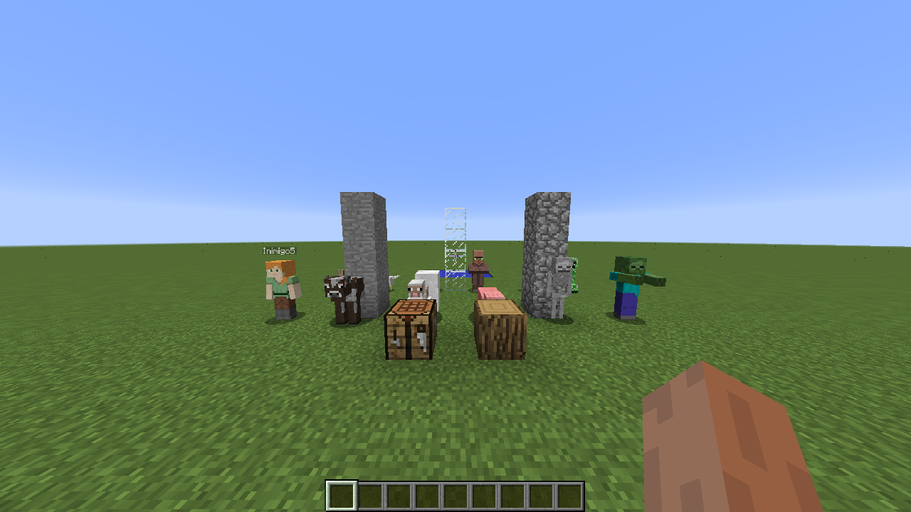
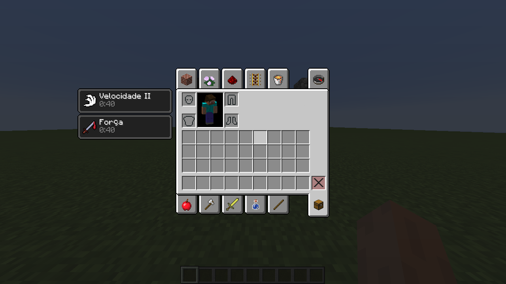
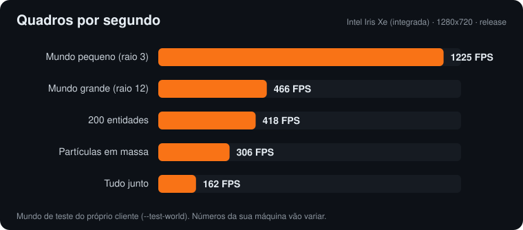
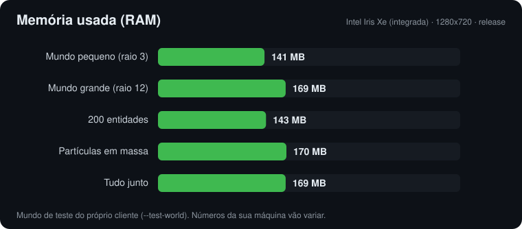
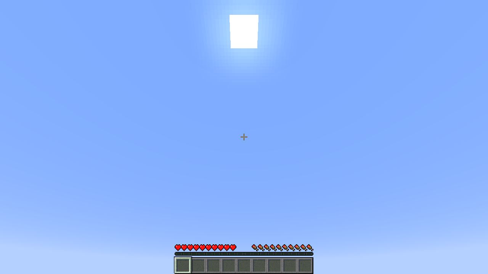
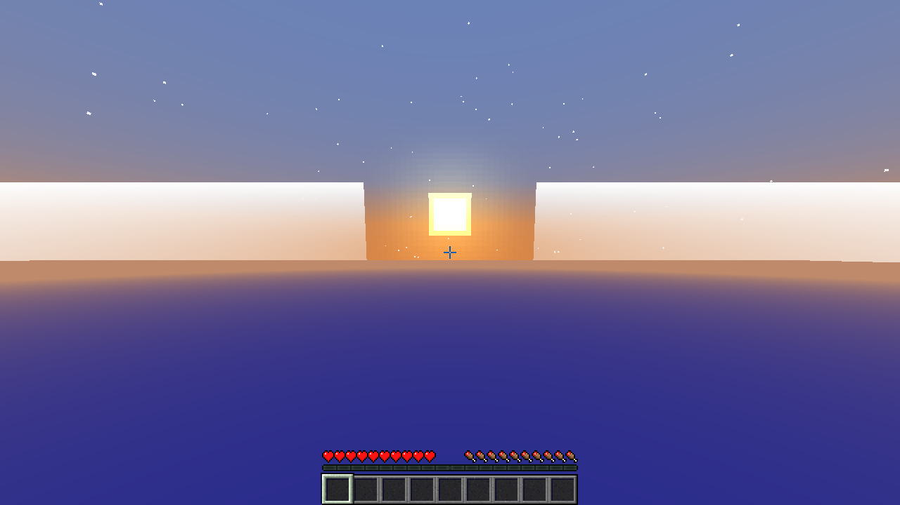
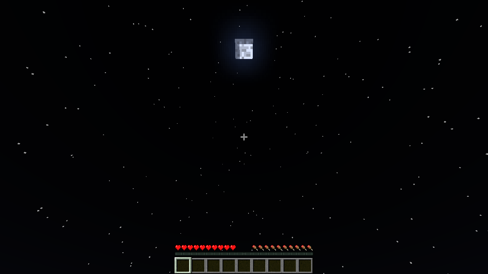
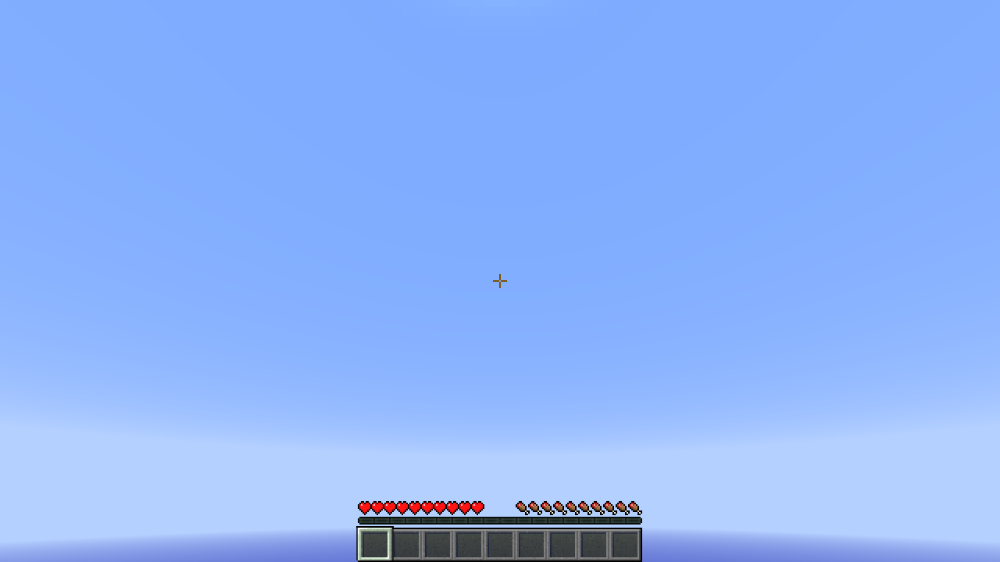
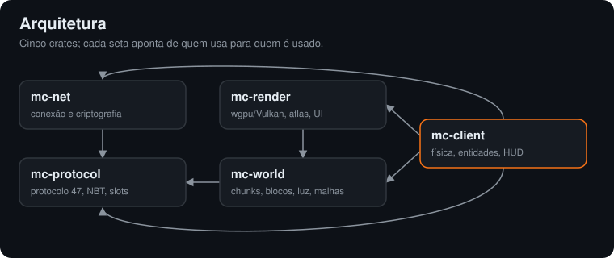

<div align="center">

# Minecraft 1.8.9 Rust

**Um cliente do Minecraft Java 1.8.9 reescrito do zero em Rust.**
Para jogar em servidores 1.8 com o jogo vanilla de sempre, mas usando uma fração da memória.


-3fb950)




</div>

---

## Sumário

- [O que é](#o-que-é)
- [Desempenho](#desempenho)
- [Windows](#windows)
- [Instalação](#instalação)
- [Primeiro uso](#primeiro-uso)
- [Conta](#conta)
- [Opções gráficas do OptiFine](#opções-gráficas-do-optifine)
- [Como funciona](#como-funciona)
- [Estrutura do código](#estrutura-do-código)
- [Testes](#testes)
- [Licença](#licença)
- [Aviso legal](#aviso-legal)
- [English](#english)

## O que é

O cliente é um port do jogo original: rede, login, mundo, física, renderização, HUD, inventários e menus foram traduzidos método por método do código do Minecraft 1.8.9, com os mesmos números. O objetivo é o comportamento do jogo vanilla com desempenho alto. Não há hacks nem mods de jogabilidade.

| | |
| --- | --- |
| 🌐 **Multiplayer** | protocolo 47, compressão, criptografia, login online (Microsoft) ou offline |
| 🧱 **Mundo** | chunks, luz, malhas com iluminação suave, água, lava, clima, céu, nuvens, borda do mundo |
| 🐄 **Entidades** | jogadores com skin e capa, todos os mobs, itens, projéteis, armor stands, hologramas |
| 🎒 **Interface** | HUD, chat com componentes, tab, placar, inventários, criativo, baús, fornos, encantamentos |
| ⚙️ **Opções** | `options.txt` do jogo, pacotes de recursos e as opções gráficas do OptiFine |



## Desempenho

Medido no mundo de teste do próprio cliente (`--test-world`), em 1280x720, numa GPU **integrada** (Intel Iris Xe).





| Cenário | FPS | Tempo por quadro | RAM |
| --- | ---: | ---: | ---: |
| Mundo pequeno (raio 3) | 1225 | 0,8 ms | 141 MB |
| Mundo grande (raio 12) | 466 | 2,1 ms | 169 MB |
| 200 entidades | 418 | 2,4 ms | 143 MB |
| Partículas em massa | 306 | 3,3 ms | 170 MB |
| Tudo junto | 162 | 6,2 ms | 169 MB |

De onde vem o desempenho:

- **Sem JVM nem coletor de lixo:** a memória fica estável, sem os travamentos de GC.
- **Terreno em draw indirect:** cada camada de blocos sai numa chamada só, com culling por seção.
- **Partículas por instância:** uma instância por partícula, com o quadrado montado no shader.
- **Tick paralelo:** entidades e partículas atualizam em várias threads quando são muitas, na mesma ordem do jogo.
- **Lote único por quadro:** entidades, textos e GUI sobem para a GPU num upload só.

Para medir na sua máquina:

```bash
MINE_RS_STATS=1 target/release/mc-client --test-world --offline
```

Os gráficos são gerados por [`scripts/gen_docs_graficos.py`](scripts/gen_docs_graficos.py); troque os números e rode de novo.

## Windows

1. Baixe o instalador: **[Minecraft-1.8.9-Rust-Instalador.exe](https://github.com/lzofseven/Minecraft-1.8.9-Rust/releases/latest/download/Minecraft-1.8.9-Rust-Instalador.exe)**.
2. Dê dois cliques nele. Não precisa de administrador; o jogo vai para `%LOCALAPPDATA%\Minecraft 1.8.9 Rust`.
3. Abra pelo atalho **Minecraft 1.8.9 Rust** na Área de Trabalho ou no Menu Iniciar.

Na primeira vez, uma janela preta mostra o download dos arquivos do jogo direto da Mojang (alguns minutos, só uma vez) e some sozinha. Para remover, use **Configurações → Aplicativos** (ou "Adicionar ou remover programas").

Se o Windows mostrar "O Windows protegeu o computador", clique em **Mais informações → Executar assim mesmo**: o instalador não tem assinatura digital paga.

| Pasta | Conteúdo |
| --- | --- |
| `%APPDATA%\mine-rs` | `options.txt`, `servers.dat`, conta |
| `%LOCALAPPDATA%\mine-rs` | jar, sons, cache de skins e terreno guardado |

Se você já tem o Minecraft 1.8.9 no launcher oficial (`%APPDATA%\.minecraft`) ou no Prism Launcher, o jogo usa esses arquivos e não baixa nada. Para gerar o instalador a partir do código (num Linux com `mingw-w64` e `nsis`): `scripts/build-windows.sh`.

## Instalação

O cliente é testado no **Linux**; no Windows, use o [instalador](#windows). macOS ainda não foi testado.

### 1. Dependências

Precisa de uma placa de vídeo com **Vulkan** e do Rust estável.

```bash
# Debian / Ubuntu
sudo apt install build-essential pkg-config libvulkan1 mesa-vulkan-drivers libxkbcommon-x11-0

# Arch
sudo pacman -S base-devel vulkan-icd-loader libxkbcommon-x11
```

Instale o Rust pelo [rustup](https://rustup.rs):

```bash
curl --proto '=https' --tlsv1.2 -sSf https://sh.rustup.rs | sh
```

### 2. Compilar

```bash
git clone https://github.com/lzofseven/Minecraft-1.8.9-Rust.git
cd Minecraft-1.8.9-Rust
cargo build --release -p mc-client
```

O binário fica em `target/release/mc-client`. A primeira compilação leva alguns minutos.

### 3. Instalar (opcional)

```bash
install -Dm755 target/release/mc-client ~/.local/bin/minecraft-rust
```

Depois é só rodar `minecraft-rust`.

## Primeiro uso

```bash
target/release/mc-client                    # abre o menu
target/release/mc-client mc.exemplo.com     # entra direto num servidor
```

O jogo **não distribui nada da Mojang**. Na primeira vez ele procura o Minecraft 1.8.9 que você já tem:

1. `~/.minecraft/versions/1.8.9/1.8.9.jar` (launcher oficial)
2. a cópia do Prism Launcher
3. sem nenhum dos dois, baixa o jar e os sons dos servidores oficiais da Mojang para `~/.local/share/mine-rs`, conferindo o SHA-1 de cada arquivo

| Pasta | Conteúdo |
| --- | --- |
| `~/.config/mine-rs` | `options.txt`, `servers.dat`, conta, `optionsof.txt` |
| `~/.local/share/mine-rs` | jar e assets baixados |

`MINE_RS_CONFIG` troca a pasta de configuração.

## Conta

Sem conta salva, o jogo abre a tela **Conta** (também no botão "Conta" do menu principal):

- **Entrar com Microsoft:** o jogo mostra um link e um código. Abra o link, digite o código e aprove. A conta fica salva em `~/.config/mine-rs/conta.json`, que só o seu usuário lê, e o token é renovado sozinho.
- **Jogar offline:** escolha um nick com 3 a 16 letras, números ou `_`.

Não precisa configurar nada: o app do projeto ("Rust 1.8.9 Client") já vem no jogo, e é o nome dele que aparece na tela de login da Microsoft. Quem preferir usar um app próprio do Azure pode trocar pelo Client ID dele com a variável `MINE_RS_MS_CLIENT_ID` ou o arquivo `~/.config/mine-rs/microsoft-client-id`.

| Opção | O que faz |
| --- | --- |
| `--offline --name NICK` | joga offline com o nick |
| `--session auth.json` | usa a sessão de um launcher (JSON com `name`, `uuid` e `access_token`) |
| `--jar minecraft-1.8.9.jar` | usa outro jar do jogo |
| `--test-world --offline` | abre o mundo de teste, sem servidor |

## Opções gráficas do OptiFine

Se existir `~/.config/mine-rs/optionsof.txt` (o mesmo formato do OptiFine), o jogo lê:

| Opção | Valor | Efeito |
| --- | --- | --- |
| `ofFogType` | `3` | sem névoa de distância |
| `ofSky`, `ofStars`, `ofSunMoon` | `false` | sem céu, estrelas ou sol e lua |
| `ofClouds` | `3` | sem nuvens |
| `ofRain` | `3` | sem chuva |
| `ofWeather` | `false` | sem chuva nem trovão |
| `ofDynamicFov` | `false` | o FOV não muda com corrida e arco |
| `ofAnimatedWater`, `ofAnimatedLava` | `2` | texturas paradas |
| `ofAnimatedFire` | `false` | fogo parado |
| `ofVignette` | `1` ou `2` | vinheta desligada ou ligada |

## Como funciona

**Nada é recriado à mão.** Tudo o que o jogo tem como dado (modelos de bloco e item, texturas, sons, traduções, fonte) é lido do jar original em tempo de execução. Já o que na 1.8 só existe como código (modelos de mob, colisões, dureza, receitas, layouts das telas) é portado com os números exatos ou gerado pelos scripts em [`scripts/`](scripts), a partir de uma cópia local do código descompilado. Essa cópia fica em `.local/` e não vai para o repositório.

| | |
| --- | --- |
|  |  |
|  |  |

O céu, a névoa, as nuvens e o mapa de luz foram conferidos contra o jogo original com as tabelas de `mc-render/src/sky_golden.txt`.

## Estrutura do código



| Crate | Conteúdo |
| --- | --- |
| [`mc-protocol`](mc-protocol) | protocolo 47 (1.8): pacotes, NBT, slots |
| [`mc-net`](mc-net) | conexão, compressão e criptografia |
| [`mc-world`](mc-world) | chunks, blocos, luz e malhas |
| [`mc-render`](mc-render) | renderizador wgpu: terreno, entidades, partículas, atlas, UI |
| [`mc-client`](mc-client) | o jogo: física, entidades, HUD, inventários, menus, som |
| [`scripts`](scripts) | geradores das tabelas a partir do código do jogo descompilado |

As notas do port estão em [`PORT.md`](PORT.md).

## Testes

```bash
cargo test --release
```

São mais de 350 testes: protocolo, física, iluminação, malhas, céu, chat, inventários, receitas e renderização das entidades, quase todos comparando com valores tirados do jogo original.

## Licença

Código sob a [GPL-3.0](LICENSE): use, estude, modifique e distribua à vontade. Quem distribuir uma versão modificada precisa publicar o código dela sob a mesma licença.

## Aviso legal

Projeto independente, **sem ligação com a Mojang ou a Microsoft**. Minecraft é marca da Mojang AB. O repositório não contém nenhum arquivo do jogo: texturas, sons e modelos são lidos da sua própria cópia do Minecraft 1.8.9.

---

## English

**Minecraft 1.8.9 Rust** is a Minecraft Java Edition 1.8.9 client rewritten from scratch in Rust. It is a method-by-method port of the original game: networking (protocol 47), Microsoft login, world, physics, wgpu/Vulkan rendering, HUD, inventories and menus. It runs at about **150 MB of RAM** and reaches **400+ FPS** on an integrated GPU (see [Desempenho](#desempenho)). No game files are distributed: textures, sounds and models are loaded from your own 1.8.9 jar, which it finds in your launcher or downloads from Mojang's official servers.

```bash
cargo build --release -p mc-client
target/release/mc-client            # menu
target/release/mc-client host:port  # join a server
```

Tested on Linux with Vulkan. On Windows, download the [one-click installer](https://github.com/lzofseven/Minecraft-1.8.9-Rust/releases/latest/download/Minecraft-1.8.9-Rust-Instalador.exe). Licensed under [GPL-3.0](LICENSE). Not affiliated with Mojang or Microsoft.
